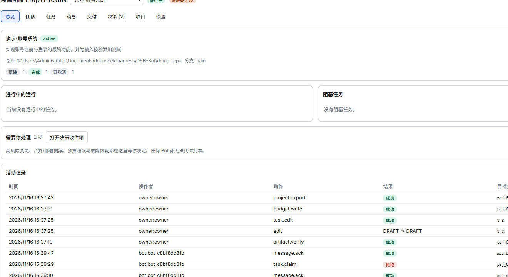
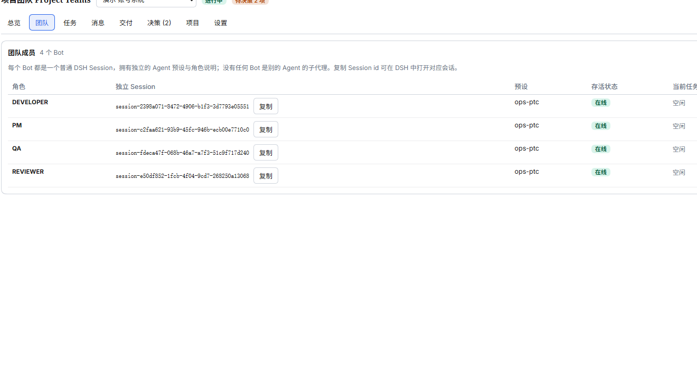
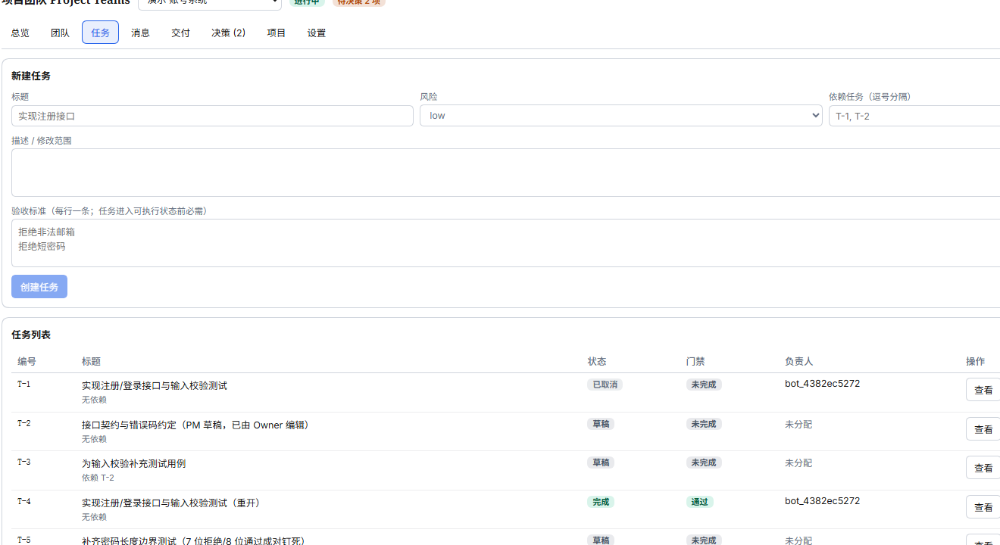
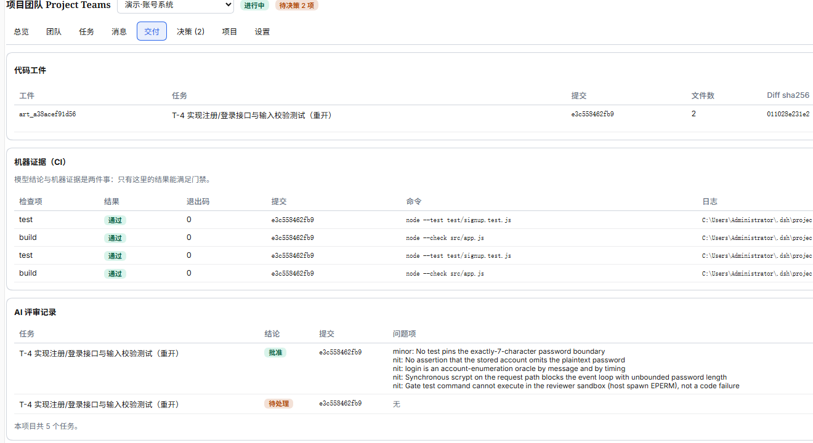
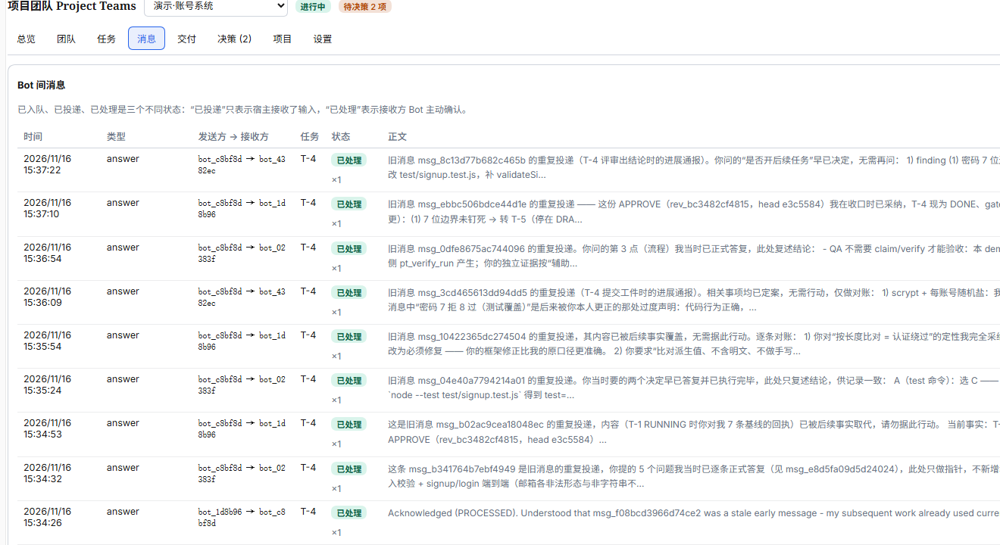
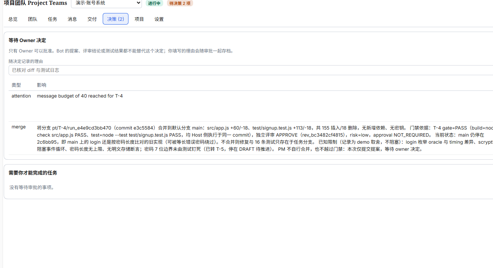
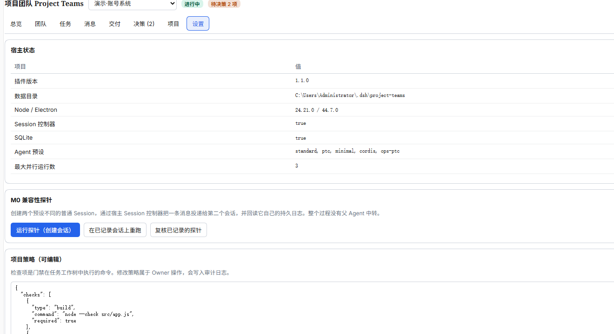

# Project Teams for DSH（项目团队）

[中文](#中文) · **English summary:** a DeepSeek Harness (DSH) plugin that turns a project into a team of
**long-lived, mutually independent DSH Sessions** — PM, Developer, Reviewer, QA. Members talk to each other
directly but are not subagents of any Agent; a deterministic Host engine (SQLite + pure state machine)
owns tasks, dependencies, leases, message delivery, git-worktree isolation, blind review and the
verification gate. A Bot can never approve its own work: machine evidence and a human owner decide.
Installed bundle, MIT licensed. Docs are in Chinese; see `docs/test-report.md` for the real end-to-end run.

一个项目一组**长期存在、彼此独立的 DSH Session**：PM、开发者（Developer）、评审（Reviewer）、QA。
Bot 之间直接沟通，而所有正式状态变更由 Host 侧确定性引擎掌握。

- **独立会话，不是子代理。** 每个 Bot 都是通过 `sessionController.create` 创建的普通 Session，
  有自己的 Agent 预设与角色说明；没有任何 Bot 是别的 Agent 的子代理，也不继承别人的对话历史。
- **确定性协调。** 任务、依赖、认领、租约、预算与审批都在代码里执行（SQLite 事务 + 纯状态机）。
  模型文字无法改变任务状态、授予权限或完成评审。
- **隔离的工程执行。** 每个写入型任务运行在自己的 `git worktree` + 分支里（位于仓库内
  `<仓库>/.project-teams/runs/<run>/worktree`，因此 Bot 的沙箱允许写入），commit、diff、命令日志都作为
  可追溯工件保存。
- **独立评审与真实门禁。** 评审者在自己的会话里拿到「盲审上下文」（需求、验收标准、diff、机器证据）；
  build/test/扫描证据来自真实命令退出码；出现新 commit 时旧评审与旧证据立刻失效；高风险工作需要 Owner
  针对确切 commit 的显式批准。
- **工作台，而不是聊天记录。** 项目、团队、任务、消息、交付、决策、设置七个视图，全部渲染宿主状态。

## 安装

```sh
# 在 profile shell 中，用本目录的绝对路径
dsh plugin --profile <profile> add /绝对路径/project-teams
```

或在 Harness 内：**插件 → 添加插件 → 本地目录**，选中本目录。
详细步骤与自检见 [`docs/installation.md`](docs/installation.md)，运维/备份/回滚见 [`docs/runbook.md`](docs/runbook.md)。

## 界面

工作台是 DSH 主区域里的一个完整面板（左侧栏「项目团队」入口），全部数据来自宿主 API：

| 总览 | 团队 | 任务 |
| --- | --- | --- |
|  |  |  |

| 交付 | 消息 | 决策 |
| --- | --- | --- |
|  |  |  |

设置（策略编辑、预算、角色模板、M0 探针）：

截图来自本机 DSH Desktop 的真实运行（项目「演示·账号系统」），不是静态 mock：
每个数字、每条消息、每次门禁结论都读自宿主数据库。截图里出现的本机路径是本项目演示机器的路径。

## 使用

1. 左侧栏打开 **项目团队**（或 设置 → 插件 → 项目团队）。
2. **项目** → 选一个本地 Git 仓库新建项目（仓库至少有一个 commit），粘贴策略检查，例如：

   ```json
   [
     { "type": "build", "command": "node --check src/app.js", "required": true },
     { "type": "test",  "command": "node --test test/signup.test.js", "required": true }
   ]
   ```

3. **团队** → *生成 4 个 Bot*。宿主创建四个独立 Session 并完成绑定。
4. **任务** → 写清标题、描述与验收标准，提交后分配给开发者 Bot。
5. 开发者在自己的会话里：`pt_task` → `claim`，`pt_task` → `start`（拿到隔离工作树），在工作树内改代码，
   `pt_task` → `submit_artifact` 提交工件，`pt_verify_run` 跑检查，`pt_review` → `request` 请求评审。
   评审者用 `pt_review` → `context` 读盲审上下文，再用 `pt_review` → `submit` 给结论。
6. **交付** 页看工件、机器证据与评审；**决策** 页只有你能批准高风险版本、合并或预算超限。

`scripts/demo-repo.mjs` 会生成一个可丢弃的示例仓库（含 build 检查与 3 个测试），几分钟就能跑完整流程。

## 环境要求

- DSH Desktop `0.2.2-rc.3`（Node 24 运行时 —— 插件使用内置 `node:sqlite`）。
- `git` 在 `PATH` 中。
- profile 组合了 `webServer`、`connection`、`sessionController`、`sessions`、`agents`、`tools`、`systemPrompt`
  （Desktop 的 `base` + `web-app` 已包含）。

## 这个插件不做什么

- 不做多人 RBAC、云端沙箱、远程 CI / PR 集成（P2 范围）。
- 工作树隔离只防写入冲突，**不是**操作系统安全边界。
- 评审结论永不替代机器证据；任何 Bot 都无法批准自己的工作。

## 文档

| 文档 | 内容 |
| --- | --- |
| [`docs/compatibility-matrix.md`](docs/compatibility-matrix.md) | 用到的每个 DSH 接口与现场证据（M0） |
| [`docs/architecture-decisions.md`](docs/architecture-decisions.md) | 为什么是独立会话、HTTP API、SQLite、worktree、盲审 |
| [`docs/api-contracts.md`](docs/api-contracts.md) | 宿主 API、工具契约、权限矩阵 |
| [`docs/task-state-machine.md`](docs/task-state-machine.md) | 任务/运行状态表、守卫、门禁规则 |
| [`docs/threat-model.md`](docs/threat-model.md) | 威胁与代码级缓解 |
| [`docs/test-report.md`](docs/test-report.md) | 测试命令、结果、AT 对照、真实端到端记录 |
| [`docs/installation.md`](docs/installation.md) | 安装、自检、升级 |
| [`docs/runbook.md`](docs/runbook.md) | 运维、恢复、备份、回滚 |

## 测试

```sh
npm test            # 66 个测试：单元 + 集成 + 安全
npm run verify:restart   # 在隔离 profile 中做两次真实进程启动，验证重启后仍能识别会话
npm run test:unit
npm run test:integration
npm run test:security
```

集成测试使用真实 SQLite 与真实 `git worktree`（临时仓库），只把 DSH 会话边界替换为假实现 ——
真实边界由运行中宿主内的 M0 探针与一次真实多 Agent 端到端运行覆盖。

## 相对规格书的完成度（§15 Definition of Done 逐条）

| DoD 要求 | 状态 | 证据 |
| --- | --- | --- |
| 当前 DSH 版本与全部关键 API 的兼容性矩阵已实测 | ✅ | `docs/compatibility-matrix.md`（C01–C11 + 现场证据） |
| 项目与 4 Bot 的独立 Session 绑定真实可用，无 root→subagent 伪装 | ✅ | M0 探针 + 真实项目（4 Session）+ 51 个测试 |
| 不同 Bot 拥有各自可恢复的 Session、角色、权限 | ✅ | 会话持久 + `verify:restart`（两次真实进程） |
| 跨 Session 消息可持久化、去重、重试、追踪，离线表现符合说明 | ✅ | 41 条真实消息 / 30 条已确认；死信与重投测试 |
| Task Engine 支持依赖、分配/认领、原子状态转移、审批与审计 | ✅ | 状态机测试 + 真实 T-4 事件链 |
| 并发代码修改不共享同一可写 checkout，分支/工件可追踪 | ✅ | 每个 run 独立 worktree + 分支；AT-07 |
| Reviewer 盲审、只读，CI 与门禁有效，不能自我审批 | ✅ | 盲审上下文 + 只读 checkout 树哈希校验 + AT-09/10 |
| UI 提供项目/团队/任务/消息/工件/决策入口，非静态 mock | ✅（渲染需你现场确认） | 全部数据来自宿主 API；slot key 与安装版一致 |
| E2E 示例项目通过适用 AT 项 | ✅ | 真实多 Agent 跑通，AT-01…AT-20 对照见测试报告 |
| 崩溃恢复、权限边界、提示注入与预算防护验证 | ✅ | 租约过期恢复 + 权限测试 + 注入测试 + 令牌/消息/并行预算 |
| 源码、可安装 Bundle、安装/使用/测试报告/已知问题/升级回滚手册 | ✅ | 本仓库 + `docs/` |

**P0 已知边界**（非缺陷，属 P1/P2）：多人 RBAC、云端沙箱、远程 CI/PR、成本仪表板、消息全文索引。

## P1 进展（v1.2.0）

| 规格 §0.4 P1 项 | 状态 | 说明 |
| --- | --- | --- |
| 项目归档 / 恢复 | ✅ | `projects.restore` + 工作台「从归档恢复」；恢复写审计 |
| 项目模板 | ✅ | 内置 `web-node`/`python`/`minimal` + Owner 可发布模板；`projects.create` 支持 `templateId`，显式字段覆盖 |
| 自定义角色 | ✅ | 能力化 ACL（coordinate/write/review/verify/message）；在角色模板声明 capabilities 即可新增角色（如 architect/frontend） |
| 消息搜索 | ✅ | `messages.list` 的 `query` + 工作台搜索框 |
| 频道 / 群组消息 | ✅ | `channel` 寻址（all / role:<r> / custom:<n>）扇出为每人一条消息并共享 thread；Owner 可广播系统通告 |
| 质量仪表板 / 成本监控 | ✅ | 新「质量」标签页：完成率、返工率、平均周期、检查通过率、findings 分布、令牌用量与预算、消息/死信、决策计数 |
| Timeline | ✅ | 工作台「时间线」标签页合并任务事件/审计/消息/检查/评审/审批，支持类型与任务筛选 |
| **合并执行器** | ✅ | Owner 批准后由 `decisions.executeMerge` 执行：重验门禁/分支/base、`--no-ff`、冲突回滚、幂等、写审计 |
| PR 集成 / 回滚 | ✅ | `decisions.createPR`（批准 + 门禁 PASS 后 push + `gh pr create`，正文由证据生成）；`decisions.rollbackMerge`（`git revert -m 1` + 留痕） |
| 双审 / 交叉模型 | ✅ | `policy.reviewCount=2` → 两个独立 reviewer 各自 blind checkout；门禁需两个 APPROVE；交叉模型用第二位 reviewer 的不同预设 |
